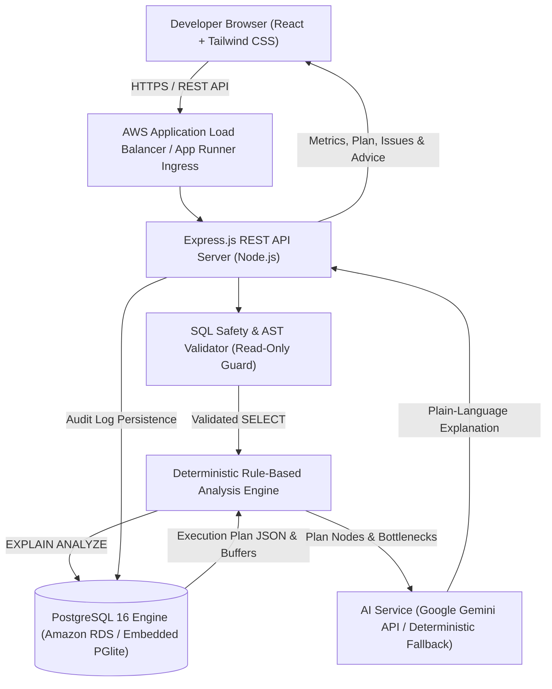
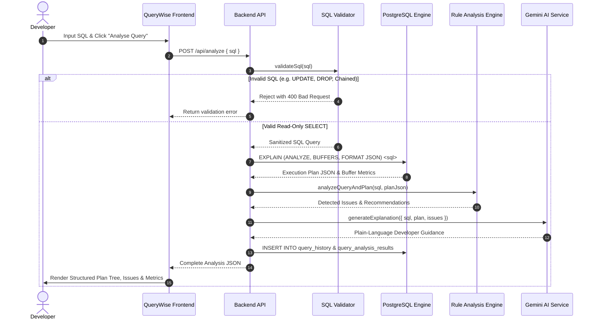

# QueryWise System Architecture

QueryWise is an AI-assisted database performance intelligence platform designed to analyze SQL execution plans, pinpoint query bottlenecks, provide rule-based recommendations, and translate complex database telemetry into human-readable developer insights.

---

## 1. High-Level Architecture Diagram

---

## 2. Component Breakdown

### A. Frontend Layer (Single-Page Application)
- **Framework**: React 18 with Vite.
- **Styling**: Tailwind CSS configured with custom light and dark mode palettes inspired by developer tools (Linear, Vercel, Supabase).
- **Icons**: Lucide React.
- **Visualizations**: Recharts for latency trend analysis, health distribution donuts, and before-and-after comparison bar charts.
- **Routing**: React Router with 5 active modules:
  - **Dashboard**: High-level database telemetry, slow query rates, and recent analyses.
  - **Query Analyzer**: Interactive SQL editor with dialect indicators, plan tree visualizer, and AI explanations.
  - **Query Comparison**: Side-by-side benchmark measuring latency and cost improvement percentages.
  - **Query History**: Searchable and filterable audit repository of previous analyses.
  - **Settings**: Live database ping, AI provider status, and environment diagnostics.

### B. API & Application Server Layer (Backend)
- **Runtime**: Node.js v22 with Express.js.
- **Architecture**: Modular service-controller-repository pattern.
- **SQL Execution Safety Guard**: Strict parser that permits only read-only `SELECT` and `WITH (CTE)` statements. Prohibits mutating statements (`INSERT`, `UPDATE`, `DELETE`, `DROP`, `ALTER`, `TRUNCATE`, `GRANT`, `REVOKE`) and multi-query chaining.
- **Unified Database Client**: Dynamic adapter that connects seamlessly to **Amazon RDS PostgreSQL** (via `pg`) when `DATABASE_URL` is configured, or boots an **Embedded PostgreSQL 16 WASM Engine (PGlite)** for zero-setup offline execution.

### C. Analysis Engine Layer
- **PostgreSQL Plan Inspector**: Executes `EXPLAIN (ANALYZE, COSTS, VERBOSE, BUFFERS, FORMAT JSON)`.
- **Deterministic Rules Engine**: Inspects both the raw SQL text and the generated PostgreSQL execution plan tree for 10 key database performance anti-patterns:
  1. Wildcard column projection (`SELECT *`)
  2. Sequential scans on large tables with missing index support
  3. Expensive sort operations spilling to disk or unindexed `ORDER BY`
  4. Inefficient filtering (leading wildcard `LIKE '%...'`)
  5. Expression-wrapped predicates (`WHERE LOWER(col) = ...`)
  6. Costly nested loop joins with high row multiplications
  7. Correlated `IN (SELECT ...)` subqueries
  8. Dominant bottleneck plan nodes consuming >50% of query cost
  9. Stale statistical estimations and unselective filters
  10. Missing foreign key join indexes

### D. AI Explanation Layer
- **Primary AI Provider**: Google Gemini API (`gemini-1.5-flash`).
- **Grounded Prompting**: Strict grounding prompt instructing the model to describe only provided metrics and never hallucinate indexes or execution times.
- **Deterministic Fallback**: If `GEMINI_API_KEY` is omitted or network connectivity fails, the engine seamlessly switches to a built-in deterministic rule-based explainer with 100% reliability.

---

## 3. End-to-End Query Analysis Sequence

