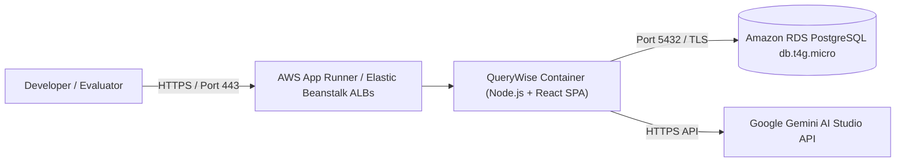

# QueryWise AWS Cloud Deployment Guide

This guide provides simple, step-by-step instructions for deploying QueryWise to Amazon Web Services (AWS) using either **AWS App Runner** (recommended for simplicity) or **AWS Elastic Beanstalk**, paired with **Amazon RDS PostgreSQL** (or the zero-config embedded PostgreSQL engine).

---

## 1. Cloud Architecture Overview



---

## 2. Option A: Deployment with AWS App Runner (Fastest & Most Reliable)

AWS App Runner provides fully managed container execution, automated HTTPS termination, load balancing, and health monitoring without managing EC2 instances.

### Step 1: Push Container to Amazon ECR (Elastic Container Registry)

1. Authenticate Docker with your AWS account:
   ```bash
   aws ecr get-login-password --region us-east-1 | docker login --username AWS --password-stdin <YOUR_AWS_ACCOUNT_ID>.dkr.ecr.us-east-1.amazonaws.com
   ```

2. Create an ECR repository:
   ```bash
   aws ecr create-repository --repository-name querywise --region us-east-1
   ```

3. Build and tag the Docker image:
   ```bash
   docker build -t querywise -f deployment/Dockerfile .
   docker tag querywise:latest <YOUR_AWS_ACCOUNT_ID>.dkr.ecr.us-east-1.amazonaws.com/querywise:latest
   ```

4. Push the image to ECR:
   ```bash
   docker push <YOUR_AWS_ACCOUNT_ID>.dkr.ecr.us-east-1.amazonaws.com/querywise:latest
   ```

### Step 2: Create the App Runner Service

1. Open the [AWS App Runner Console](https://console.aws.amazon.com/apprunner).
2. Click **Create service**.
3. Select **Container registry** -> **Amazon ECR**.
4. Browse and select your `querywise:latest` image.
5. In **Service settings**:
   - Service name: `querywise-app`
   - CPU & Memory: **1 vCPU, 2 GB Memory** (Free Tier / Lowest cost tier)
   - Port: `5000`
6. Under **Environment variables**, configure:
   - `NODE_ENV`: `production`
   - `PORT`: `5000`
   - `DATABASE_URL`: `postgres://<username>:<password>@<rds-endpoint>:5432/querywise_db` (or leave empty to use embedded PostgreSQL)
   - `GEMINI_API_KEY`: `your_gemini_api_key_here` (optional)
7. Health check:
   - Protocol: `HTTP`
   - Path: `/health`
   - Healthy threshold: `1`
   - Interval: `10`
8. Click **Create & deploy**.
9. In 3-5 minutes, App Runner provisions a live public HTTPS URL (e.g. `https://xyz123.us-east-1.awsapprunner.com`).

---

## 3. Option B: Deployment with AWS Elastic Beanstalk

AWS Elastic Beanstalk deploys and manages applications in the AWS Cloud without worrying about the infrastructure that runs those applications.

### Step 1: Initialize Elastic Beanstalk
```bash
# Install EB CLI if not already installed: pip install awsebcli
eb init -p docker querywise-app --region us-east-1
```

### Step 2: Configure Environment Variables
Create or update `.ebextensions/environment.config`:
```yaml
option_settings:
  aws:elasticbeanstalk:application:environment:
    NODE_ENV: production
    PORT: 5000
    DATABASE_URL: "postgres://<user>:<password>@<rds-endpoint>:5432/querywise_db"
    GEMINI_API_KEY: "your_gemini_api_key"
```

### Step 3: Deploy Application
```bash
eb create querywise-prod-env --single-instance --instance-types t3.small
eb open
```

---

## 4. Amazon RDS PostgreSQL Setup

To pair QueryWise with an official Amazon RDS PostgreSQL database:

1. In the AWS Console, navigate to **Amazon RDS** -> **Databases** -> **Create database**.
2. **Engine**: PostgreSQL (Version 16.x).
3. **Template**: **Free Tier**.
4. **DB instance identifier**: `querywise-postgres`.
5. **Master username**: `querywise_admin`.
6. **Master password**: Set a secure password.
7. **Instance class**: `db.t4g.micro` or `db.t3.micro` (Free Tier eligible: 750 hours/month).
8. **Storage**: General Purpose SSD (gp2), 20 GiB.
9. **Public access**: Choose **Yes** if connecting from outside your VPC, or assign the App Runner / EC2 Security Group.
10. Click **Create Database**.
11. Once the status turns to **Available**, copy the **Endpoint** (e.g., `querywise-postgres.c123456789.us-east-1.rds.amazonaws.com`).
12. Initialize the schema:
    ```bash
    psql -h <RDS_ENDPOINT> -U querywise_admin -d postgres -f sql/schema.sql
    ```
13. Set your `DATABASE_URL` environment variable:
    ```
    DATABASE_URL=postgres://querywise_admin:<PASSWORD>@<RDS_ENDPOINT>:5432/postgres
    ```

### Alternative Hosted PostgreSQL (Supabase / Neon / Railway)
If your AWS student account has restricted RDS permissions, you can use a hosted PostgreSQL service (such as Neon, Supabase, or Railway) by simply pasting their PostgreSQL connection string into `DATABASE_URL`.

### Fallback (Embedded PGlite)
If no external database is configured, QueryWise automatically runs its embedded PostgreSQL 16 WASM engine inside the container. This guarantees 100% functionality without incurring any external database charges.

---

## 5. Cost Analysis & Keeping Expenses Low

For a college project, staying within the AWS Free Tier is critical:

| AWS Resource | Tier / Specification | Monthly Cost | Notes |
| :--- | :--- | :--- | :--- |
| **AWS App Runner** | 1 vCPU, 2 GB (Active only on requests) | ~$5.00 / month | Pauses compute when idle; very low cost. |
| **Amazon RDS PostgreSQL** | `db.t4g.micro` (750 hours free/mo) | **$0.00** (Free Tier) | Valid for first 12 months of AWS account. |
| **ECR Container Registry** | Under 500 MB private storage | **$0.00** (Free Tier) | 500 MB/month free tier. |
| **Google Gemini API** | `gemini-1.5-flash` | **$0.00** | Free tier on Google AI Studio up to 15 RPM. |

> [!CAUTION]
> Always stop or delete your RDS instance (`aws rds delete-db-instance`) after final project evaluation to prevent unexpected charges once the Free Tier concludes.

---

## 6. Pre-Deployment Verification Checklist

- [x] Dockerfile builds cleanly without warnings (`docker build -t querywise -f deployment/Dockerfile .`).
- [x] Backend serves production frontend bundle from `/` root.
- [x] Health check endpoint `/health` returns HTTP 200 with database status.
- [x] SQL safety validator blocks any non-SELECT query.
- [x] Application functions identically with or without `GEMINI_API_KEY`.
- [x] Container executes without requiring root privileges.

