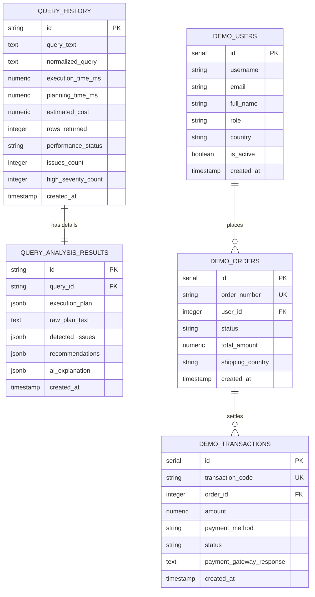

# QueryWise Database Schema Documentation

QueryWise uses PostgreSQL for both application audit persistence and its sandbox evaluation dataset.

---

## 1. Entity-Relationship Diagram

---

## 2. Table Definitions

### A. Application Audit Tables

#### 1. `query_history`
Stores metadata and summary performance metrics for all analyzed queries.
- `id` (VARCHAR(36), PK): UUID identifier.
- `query_text` (TEXT, NOT NULL): The exact SQL statement submitted.
- `normalized_query` (TEXT): Query stripped of redundant whitespace.
- `execution_time_ms` (NUMERIC(20, 3)): Actual execution time measured in milliseconds.
- `planning_time_ms` (NUMERIC(20, 3)): Time taken by the planner to compute execution paths.
- `estimated_cost` (NUMERIC(20, 2)): PostgreSQL planner total cost score.
- `rows_returned` (INTEGER): Rows returned by execution or estimated by planner.
- `performance_status` (VARCHAR(20)): Health classification (`'optimal'`, `'warning'`, `'slow'`).
- `issues_count` (INTEGER): Total count of detected issues.
- `high_severity_count` (INTEGER): Count of critical bottlenecks detected.
- `created_at` (TIMESTAMP WITH TIME ZONE): Analysis timestamp.
- **Indexes**:
  - `idx_query_history_created_at` on `(created_at DESC)`
  - `idx_query_history_status` on `(performance_status)`

#### 2. `query_analysis_results`
Stores detailed execution plan nodes, raw text, and AI responses.
- `id` (VARCHAR(36), PK): UUID.
- `query_id` (VARCHAR(36), FK -> `query_history.id` ON DELETE CASCADE).
- `execution_plan` (JSONB): Parsed execution plan tree structure.
- `raw_plan_text` (TEXT): Unmodified text output from PostgreSQL `EXPLAIN`.
- `detected_issues` (JSONB): Array of detected issues with severity, evidence, and fix.
- `recommendations` (JSONB): Array of actionable optimization recommendations.
- `ai_explanation` (JSONB): Plain-language summary, root-cause breakdown, and next steps.
- `created_at` (TIMESTAMP WITH TIME ZONE): Record creation time.
- **Index**:
  - `idx_query_analysis_query_id` on `(query_id)`

---

## 3. Demo Dataset Tables (Evaluation Sandbox)

The demo schema contains 6,650 realistic records designed to demonstrate index scans vs sequential scans, multi-table joins, and sorting bottlenecks.

| Table Name | Initial Seed Count | Purpose in Query Evaluation |
| :--- | :--- | :--- |
| `demo_users` | 500 rows | Demonstrates point primary key lookups (`id = 42`) and country filtering. |
| `demo_products` | 150 rows | Demonstrates column projection bloat (`SELECT *`) vs selective projections. |
| `demo_orders` | 3,000 rows | Demonstrates unindexed sequential scans vs index scans on status/date. |
| `demo_transactions` | 3,000 rows | Demonstrates multi-table joins, payment gateway payload handling, and aggregation. |

### Indexing Design Note
Foreign key indexes on `demo_orders(user_id)` and `demo_orders(status)` are intentionally unindexed by default. This permits users to run queries against `demo_orders` and observe genuine **Sequential Scan** bottlenecks, and then apply QueryWise's recommended `CREATE INDEX` statement to verify the speedup in the **Comparison** tool.

